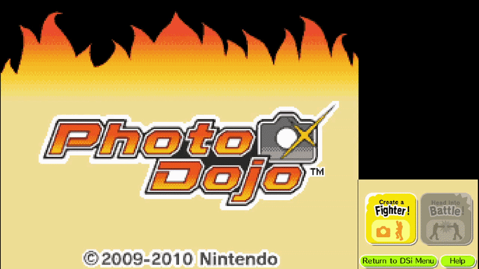

# Photo Dojo Arcade Controller

## Overview

Photo Dojo Arcade Controller is a compatibility patch built for the theming team of a weekend fighting-game-themed convention with an attendance of nearly 8,000 people. It adapted *Photo Dojo* (Nintendo DSi, 2009), running through the MelonDS emulator, to work on a two-display arcade cabinet built specifically for the event. Over the course of the weekend, the exhibit was played by an estimated several hundred attendees.

## Problem

*Photo Dojo* was designed around the DSi's dual-screen, single-device form factor. Character creation requires the player to physically rotate the console and interact with a touch screen, and gameplay depends on constant, tightly coupled communication between the top and bottom screens. None of this matched the cabinet built for the convention:

- The cabinet used two separate physical displays rather than a single foldable device, with a primary display for top-screen fighting gameplay and a smaller touch-enabled secondary display for the bottom screen.
- Physically rotating a fixed, cabinet-mounted display was not possible, but character creation still required the top/bottom screen relationship the game expected.

## Solution

I built the controller software in Python and ran it on a Windows 10 PC connected to the two arcade displays, sitting alongside MelonDS to translate the game's expectations into something the cabinet hardware could actually support. Development took place over roughly three months, from June to September.

### Technical Stack

- **Python** as the core language for the controller application
- **Tkinter** for the user interface layer
- **Pygame** and **Pynput** for capturing controller and keyboard input events in real time
- **PyDirectInput** for constructing and executing macros against the emulator
- **OpenCV** for image recognition used in automatic screen detection and adjustment

### Automatic Screen Swapping via Image Recognition

Since the cabinet could not be physically rotated, I used OpenCV to detect when the game transitioned into character creation and automatically swap which physical display showed which emulated screen. This reproduced the effect of rotating the console without requiring any physical movement of the hardware, and did so without staff intervention.

### Macro-Based Configuration and Recovery

Pygame and Pynput handled real-time input capture, which fed into a set of macros triggered by controller combo inputs, allowing for control of the game state and loading fallbacks.

This kept the exhibit resilient during a high-traffic weekend, letting attendants recover from an unstable state or preserve a working setup without needing to dig into the emulator directly.

### Controller Customization for Compatibility

Since the cabinet's controller hardware could vary, I built a configuration system that let each button or hat axis be mapped individually, supporting different controller layouts. A keyboard mode was also supported as a fallback when no joystick was set, making the controller adaptable to whatever input hardware was available at setup.

## Impact

- Supported an exhibit played by an estimated several hundred attendees over the weekend
- Adapted a single-device, rotation-dependent DSi game to a fixed, dual-display arcade cabinet
- Reduced the need for staff intervention through combo-triggered recovery and save macros
- Supported multiple controller types through a configurable button mapping system, improving compatibility across whatever hardware was available at the event