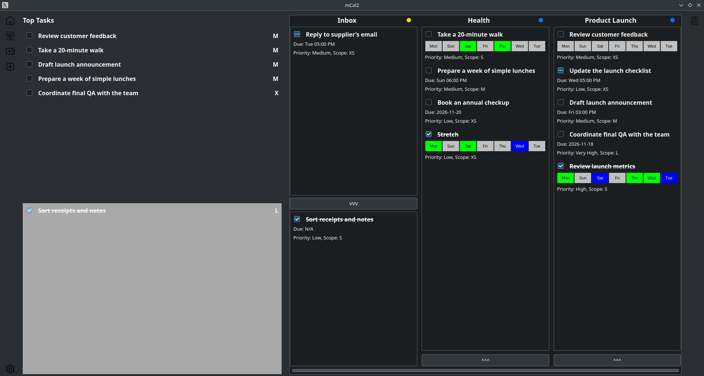

# mCal2

## A personal calendar and task management application

**Overview**

mCal is a personal productivity application designed to bring projects, daily tasks, and long-term habits into one place. Rather than treating every task as an isolated item, mCal organizes work into flexible groups called *taskblocks*, making it easier to manage everything from individual projects to ongoing personal goals.

I created mCal to address a problem I encountered with traditional task managers: as the number of my projects grew, it became increasingly difficult to keep track of how individual tasks contributed to larger goals. I wanted a system that made organizing work quick and intuitive while helping me decide what to focus on next.

## Designed around the way people work

mCal combines several productivity concepts into a single interface:

- **Flexible organization:** Group related tasks into taskblocks representing projects, areas of responsibility, or ongoing goals.
- **Habit tracking:** Set recurring goals based on specific weekdays or frequencies, keeping long-term habits alongside everyday tasks.
- **Priority-based organization:** Surface the most urgent tasks and taskblocks first, helping users identify what deserves their attention.
- **Flexible project management:** Pause projects, mark them complete, or pin important work for easier access.

The goal is to reduce the effort required to organize work so that users can spend more time doing it.

## Technical architecture

The client is implemented entirely in C++, with Qt providing the user interface infrastructure and event-driven application framework. SQLite3 handles local data management and storage so users can keep their task and habit data available even when offline or working across devices.

The server side runs on Python with FastAPI and uses its own SQLite database for persistent storage. I track changes as they occur and merge them in a way that preserves as much information as possible between database updates, helping maintain continuity when data changes overlap or require reconciliation.

## An application built to grow

I developed mCal as a multiplatform application with synchronized data between clients. This allows the application to extend beyond a single device while maintaining a consistent view of tasks and habits.

Throughout development, I have worked across the user experience, application behavior, and data management needed to bring these pieces together. The project reflects my interest in building practical software that combines thoughtful interface design with reliable underlying systems.

## Project status

mCal remains an active work in progress. I continue to develop its features and refine the experience as the application evolves.

**Explore the project:** [View the source code on GitHub](https://github.com/marobeck/mCal2)